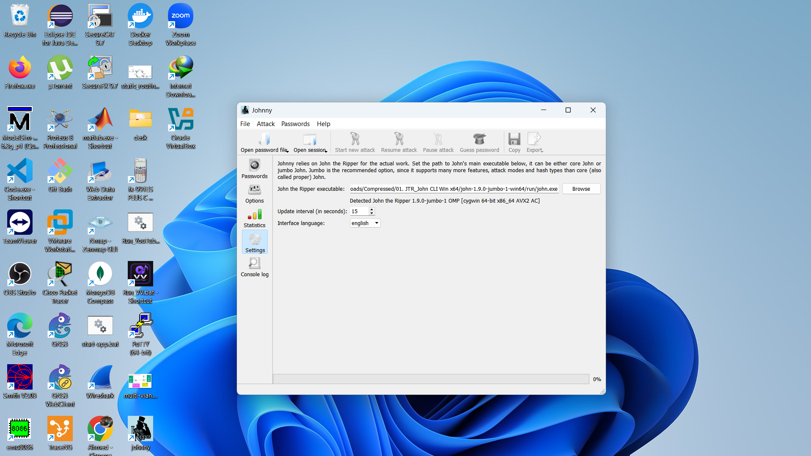
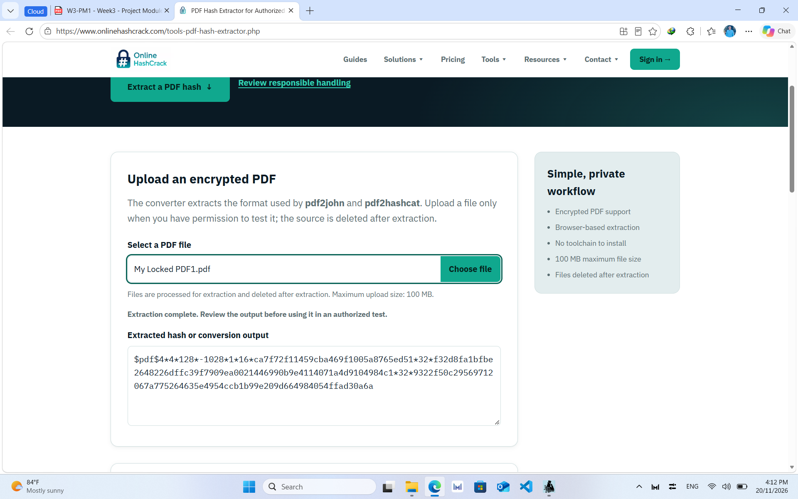
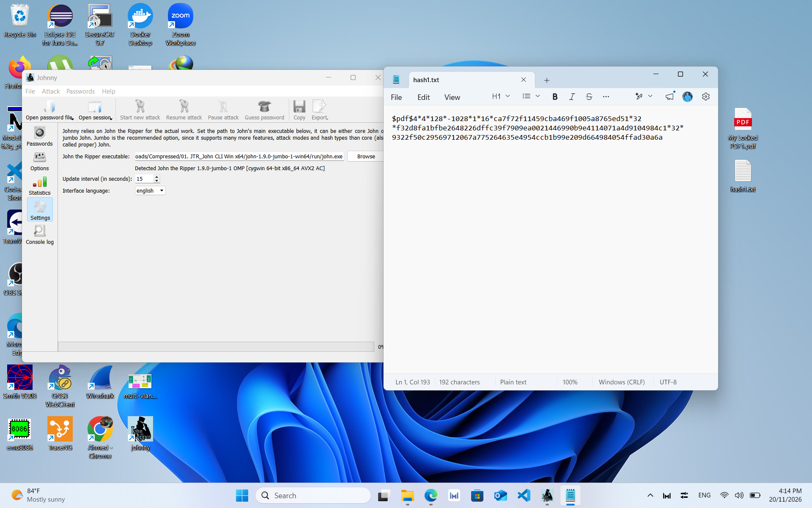
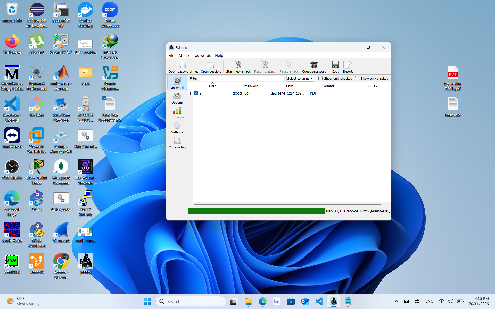
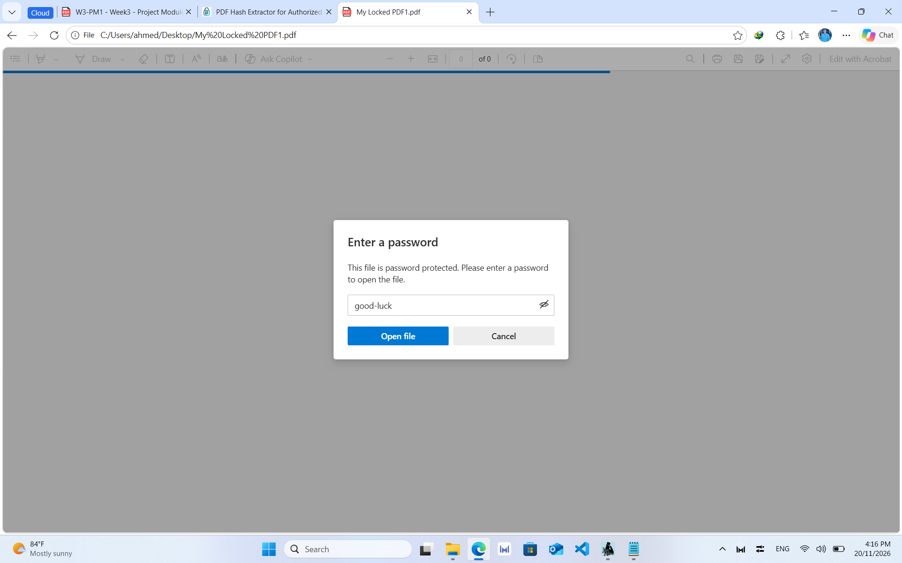
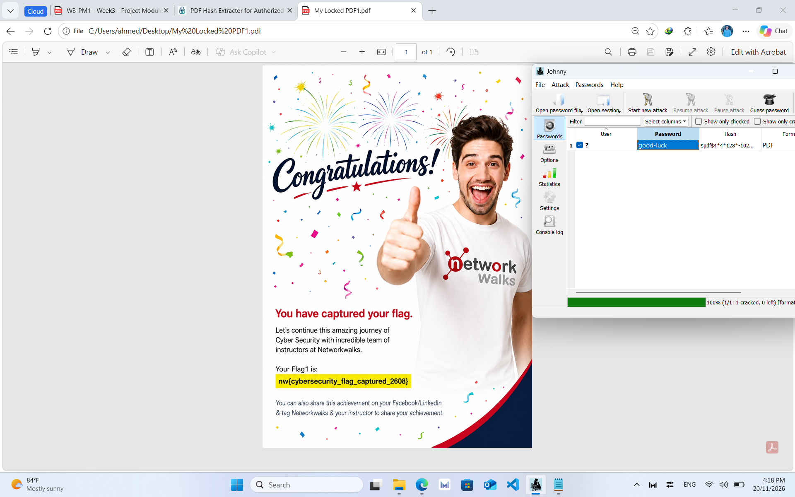

# Password Cracking with JTR (John the Ripper) — Networkwalks W3-PM1

Week 3 - Project Module 1 of the Networkwalks Cybersecurity & Ethical Hacking internship: recovering the password of a protected PDF file using **John the Ripper (JTR)** and its GUI front-end, **Johnny**.

## Objective

Crack the password of an encrypted PDF (`My Locked PDF1.pdf`) using JTR John and JTR Johnny on a Windows PC, to understand how password cracking works and why strong passwords matter.

## Tools Used

- **John the Ripper (jumbo)** v1.9.0-jumbo-1 — Windows CLI build
- **Johnny** — GUI front-end for JTR
- **Online Hash Crack — PDF Hash Extractor** (`onlinehashcrack.com`) — used to convert the encrypted PDF into a crackable `$pdf$...` hash via `pdf2john`

## Steps

### 1. Point Johnny to the John executable

Opened Johnny → Settings → browsed to `john.exe` inside the extracted jumbo build (`JTR_John CLI Win x64/john-1.9.0-jumbo-1-win64/run/john.exe`). Johnny confirmed: *Detected John the Ripper 1.9.0-jumbo-1 OMP [cygwin 64-bit x86_64 AVX2 AC]*.



### 2. Extract the PDF's hash

Uploaded `My Locked PDF1.pdf` to the Online Hash Crack PDF Hash Extractor, which runs `pdf2john`/`pdf2hashcat` under the hood. Got back a hash in the format:

```
$pdf$4*4*128*-1028*1*16*ca7f72f11459cba469f1005a8765ed51*32*f32d8fa1bfbe2648226dffc39f7909ea0021446990b9e4114071a4d9104984c1*32*9322f50c29569712067a775264635e4954ccb1b99e209d664984054ffad30a6a
```



### 3. Save the hash

Pasted the hash into Notepad and saved it as `hash1.txt`.



### 4. Load the hash into Johnny and run the attack

Used *Open password file* in Johnny and selected `hash1.txt`. Clicked *Start new attack*. John ran through its default cracking modes and recovered the password in full — *100% (1/1: 1 cracked, 0 left) [format=PDF]*.

**Cracked password:** `good-luck`



### 5. Verify the password on the PDF

Opened `My Locked PDF1.pdf` and entered `good-luck` at the password prompt.



### 6. Confirm success

The file unlocked successfully, revealing the challenge flag.



## Result

🎉 PDF successfully unlocked. The document revealed the challenge flag:

```
nw{cybersecurity_flag_captured_2608}
```

## Key Takeaway

`pdf2john` converts a password-protected PDF's encryption metadata into a hash format JTR can attack offline, without needing to interact with the PDF reader itself. From there, JTR's default wordlist/rule-based attack modes can recover weak or common passwords quickly — a good illustration of why strong, non-dictionary passwords matter even for "simple" file protection.

---
*Part of the [Networkwalks](https://www.networkwalks.com) Cybersecurity & Ethical Hacking internship program.*
