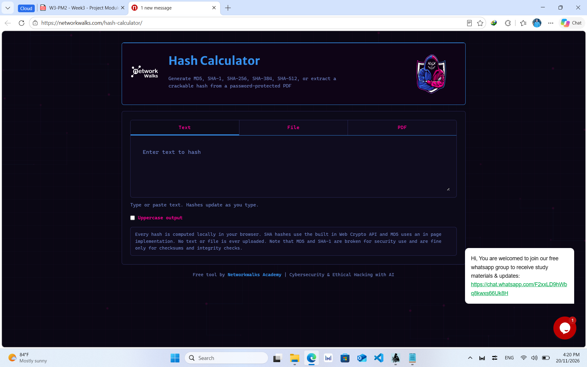
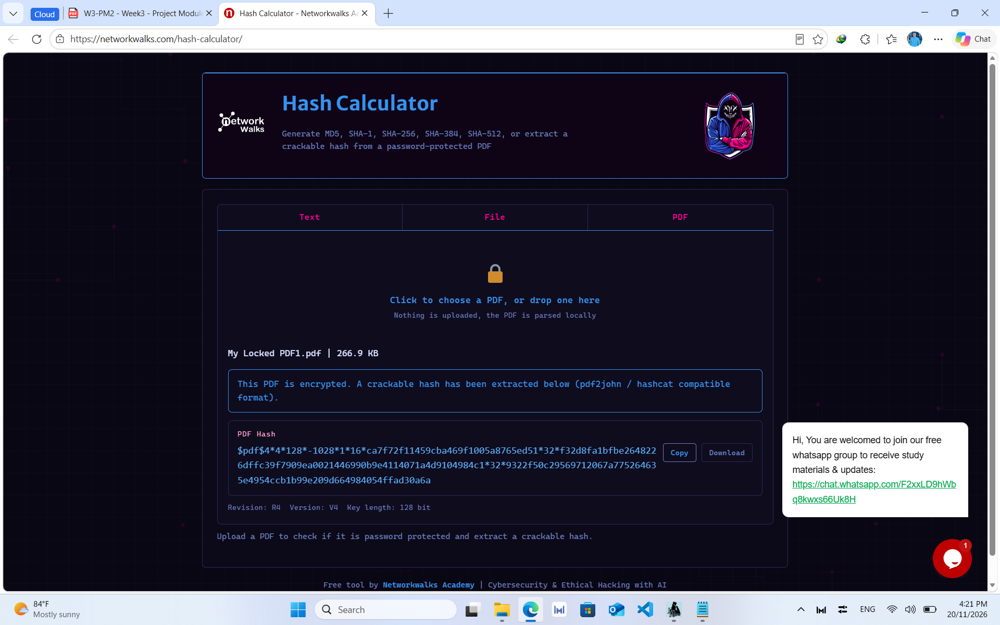
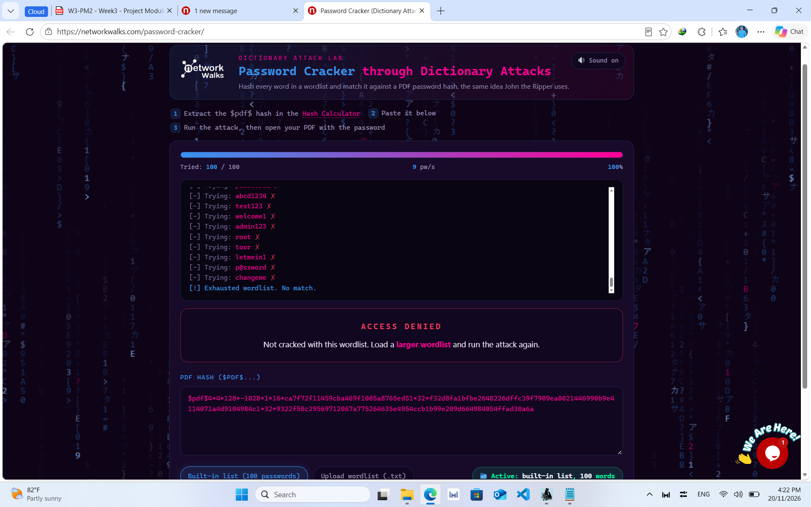
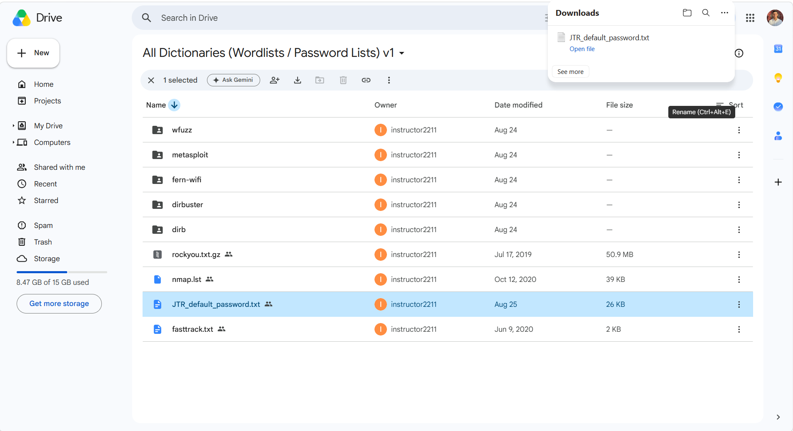
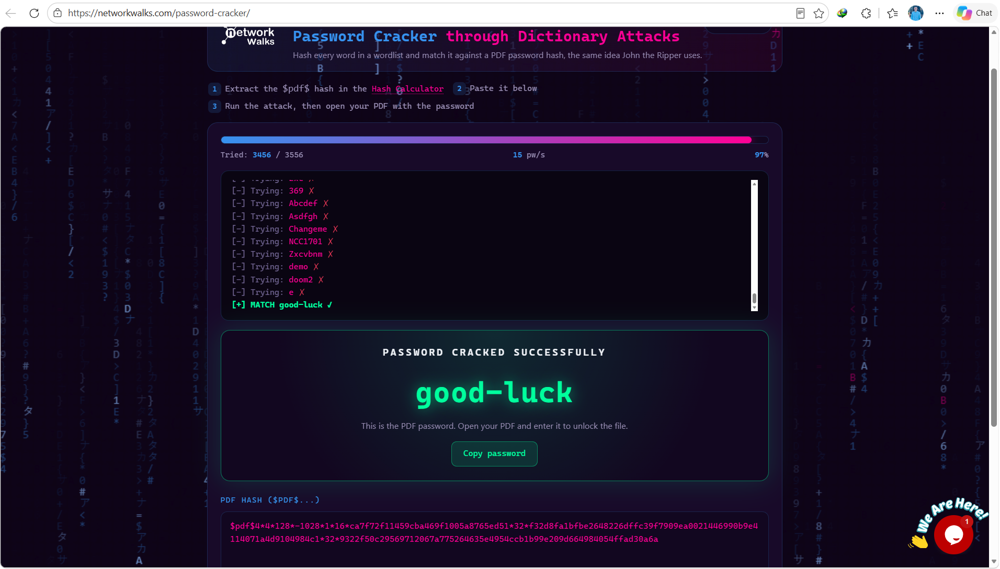
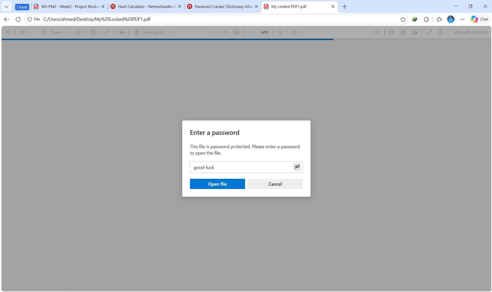
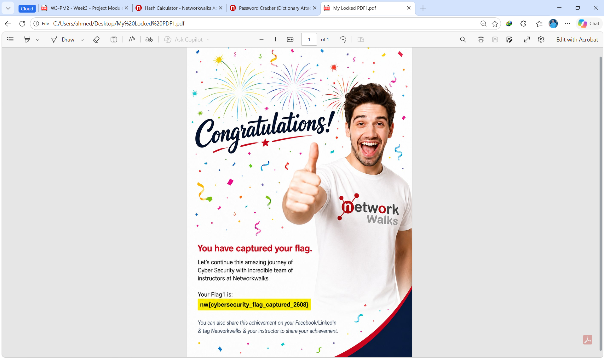

# Password Cracking with Networkwalks Tools — W3-PM2

Week 3 - Project Module 2 of the Networkwalks Cybersecurity & Ethical Hacking internship: recovering the password of a protected PDF file using **Networkwalks' own free browser-based tools** — the Hash Calculator and the Password Cracker — instead of installing John the Ripper locally.

## Objective

Crack the password of an encrypted PDF (`My Locked PDF1.pdf`) using the Networkwalks Hash Calculator and Password Cracker tools, both of which run entirely in the browser with nothing to install.

## Tools Used

- **Networkwalks Hash Calculator** ([networkwalks.com/hash-calculator](https://networkwalks.com/hash-calculator/)) — extracts a `pdf2john`/hashcat-compatible `$pdf$...` hash from a password-protected PDF, computed locally in the browser
- **Networkwalks Password Cracker — Dictionary Attack Lab** ([networkwalks.com/password-cracker](https://networkwalks.com/password-cracker/)) — runs a wordlist against the extracted hash, the same idea John the Ripper uses

## Steps

### 1. Open the Hash Calculator and upload the PDF

Opened the Networkwalks Hash Calculator and selected the **PDF** tab.



### 2. Extract the hash

Uploaded `My Locked PDF1.pdf`. The tool confirmed the file is encrypted and extracted a crackable hash (pdf2john / hashcat compatible format):

```
$pdf$4*4*128*-1028*1*16*ca7f72f11459cba469f1005a8765ed51*32*f32d8fa1bfbe2648226dffc39f7909ea0021446990b9e4114071a4d9104984c1*32*9322f50c29569712067a775264635e4954ccb1b99e209d664984054ffad30a6a
```



### 3. First attempt — built-in wordlist (100 words)

Pasted the hash into the Password Cracker and ran the attack with the tool's built-in 100-word list. It tried all 100 entries but found no match.

**Result: Access Denied** — *"Not cracked with this wordlist. Load a larger wordlist and run the attack again."*



### 4. Get a larger wordlist

Downloaded a bigger password dictionary (`JTR_default_password.txt`) from a shared wordlist collection to use instead of the built-in list.



### 5. Second attempt — larger wordlist succeeds

Uploaded the larger wordlist and ran the attack again. This time it found a match after trying 3,456 of 3,556 words.

**Cracked password:** `good-luck`



### 6. Verify the password on the PDF

Opened `My Locked PDF1.pdf` and entered `good-luck` at the password prompt.



### 7. Confirm success

The file unlocked successfully, revealing the challenge flag.



## Result

🎉 PDF successfully unlocked. The document revealed the challenge flag:

```
nw{cybersecurity_flag_captured_2608}
```

## Key Takeaway

The built-in 100-word list wasn't enough to crack `good-luck` — it only succeeded once a larger, more varied wordlist (3,556 entries) was loaded. This mirrors real dictionary attacks: cracking success depends heavily on wordlist coverage, not just the tool itself. It's also a good reminder that even a password that *looks* non-trivial (not a simple "123456") can still fall to a sufficiently large dictionary if it isn't random enough.

---
*Part of the [Networkwalks](https://www.networkwalks.com) Cybersecurity & Ethical Hacking internship program.*
